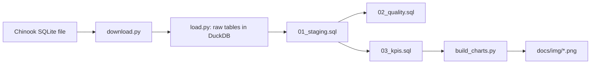

# Chinook sales analytics

<!-- ONE sentence in your words: what this project does and what
questions it answers. -->


## Business questions
<!-- The 3 questions, one line each:
1. How does revenue develop per year?
2. Which genres bring the most revenue?
3. Which artists bring the most revenue? -->

## Key findings
<!-- 3 findings. For each: one chart, then 2-3 sentences:
what you expected, what the data showed, what surprised you.
Don't copy numbers you can't explain. -->

### 1. Revenue per year


### 2. Revenue by genre
<!-- chart is at the top; you can reuse or move it -->

### 3. Revenue by artist


## Data quality
<!-- 13 checks, all passed. Explain in 3-4 sentences what you checked
(sums, missing links between tables, duplicate keys, dates, amounts).
Add the story about the false alarm: comparing sums on DOUBLE numbers
showed 56 mismatches, and switching to DECIMAL fixed it. Say what you learned. -->

## Limitations
<!-- Be honest: sample database, only 5 years, last year ends 22 Dec,
many artists with few sales, how revenue by genre/artist is defined. -->

## How it works

Layers: raw (copied as is) → staging (typed, renamed) → quality checks and KPIs → charts.
KPI definitions and their limits: [docs/kpi_definitions.md](docs/kpi_definitions.md).

## How to run
```
make setup      # virtual environment and dependencies
make download   # fetch the Chinook SQLite file
make load       # raw tables into DuckDB
make sql        # staging views, quality checks, KPI views
make charts     # PNG charts into docs/img/
```

## Project structure
<!-- Short table or list: src/, sql/, docs/, data/ and what each holds.
You can link docs/project_structure.md if you keep it. -->

## Data and license
Data: Chinook sample database by Luis Rocha
(https://github.com/lerocha/chinook-database), used under its license
(see the LICENSE.md in that repository). The raw data is not stored here;
`make download` fetches it. Code: MIT. Educational portfolio project.

## Lühikokkuvõte
<!-- 3-4 sentences in Estonian: what the project does, what data it uses,
what you found. -->