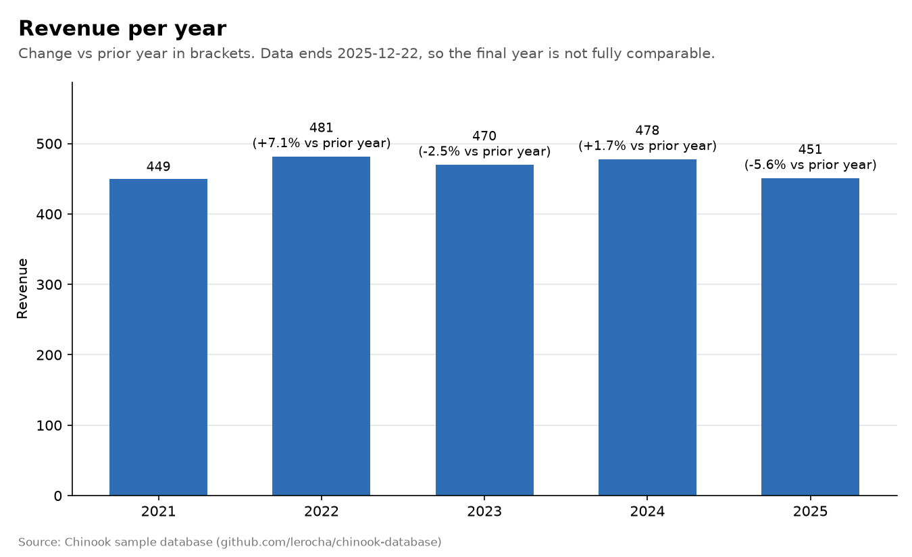
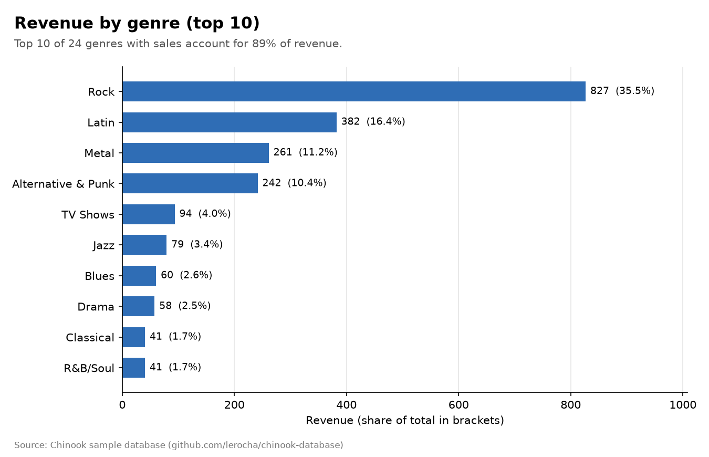
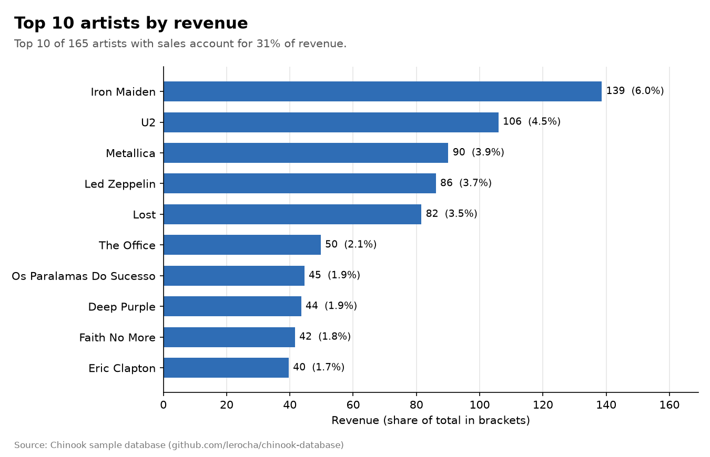

# KPI report

Generated by `src/report.py` on 2026-10-17. Do not edit by hand.

## Data coverage

- Invoices: 412 from 59 customers
- Period: 2021-01-01 to 2025-12-22
- Total revenue: 2,328.60

## Data quality

13 of 13 checks passed. Checks are defined in `sql/02_quality.sql`.

| Check | Failed rows | Checked rows | Status |
|---|---|---|---|
| amounts_positive | 0 | 2240 | pass |
| invoice_date_valid | 0 | 412 | pass |
| invoice_has_country | 0 | 412 | pass |
| invoice_has_customer | 0 | 412 | pass |
| invoice_has_lines | 0 | 412 | pass |
| invoice_id_unique | 0 | 412 | pass |
| invoice_line_id_unique | 0 | 2240 | pass |
| invoice_total_matches_lines | 0 | 412 | pass |
| invoice_total_positive | 0 | 412 | pass |
| line_has_invoice | 0 | 2240 | pass |
| line_has_track | 0 | 2240 | pass |
| track_has_genre | 0 | 3503 | pass |
| track_id_unique | 0 | 3503 | pass |

## KPI 1: Revenue per year

| Year | Invoices | Customers | Revenue | Avg invoice | Last invoice | YoY change |
|---|---|---|---|---|---|---|
| 2021 | 83 | 46 | 449.46 | 5.42 | 2021-12-26 | – |
| 2022 | 83 | 46 | 481.45 | 5.80 | 2022-12-25 | +7.12% |
| 2023 | 83 | 47 | 469.58 | 5.66 | 2023-12-27 | -2.47% |
| 2024 | 83 | 47 | 477.53 | 5.75 | 2024-12-30 | +1.69% |
| 2025 | 80 | 46 | 450.58 | 5.63 | 2025-12-22 | -5.64% |

## KPI 2: Revenue by genre

| Rank | Genre | Revenue | Units sold | Share | Cumulative share |
|---|---|---|---|---|---|
| 1 | Rock | 826.65 | 835 | 35.50% | 35.50% |
| 2 | Latin | 382.14 | 386 | 16.41% | 51.91% |
| 3 | Metal | 261.36 | 264 | 11.22% | 63.13% |
| 4 | Alternative & Punk | 241.56 | 244 | 10.37% | 73.51% |
| 5 | TV Shows | 93.53 | 47 | 4.02% | 77.52% |
| 6 | Jazz | 79.20 | 80 | 3.40% | 80.93% |
| 7 | Blues | 60.39 | 61 | 2.59% | 83.52% |
| 8 | Drama | 57.71 | 29 | 2.48% | 86.00% |
| 9 | Classical | 40.59 | 41 | 1.74% | 87.74% |
| 9 | R&B/Soul | 40.59 | 41 | 1.74% | 89.48% |
| 11 | Sci Fi & Fantasy | 39.80 | 20 | 1.71% | 91.19% |
| 12 | Reggae | 29.70 | 30 | 1.28% | 92.47% |
| 13 | Pop | 27.72 | 28 | 1.19% | 93.66% |
| 14 | Soundtrack | 19.80 | 20 | 0.85% | 94.51% |
| 15 | Comedy | 17.91 | 9 | 0.77% | 95.28% |
| 16 | Hip Hop/Rap | 16.83 | 17 | 0.72% | 96.00% |
| 17 | Bossa Nova | 14.85 | 15 | 0.64% | 96.64% |
| 18 | Alternative | 13.86 | 14 | 0.60% | 97.23% |
| 19 | World | 12.87 | 13 | 0.55% | 97.79% |
| 20 | Science Fiction | 11.94 | 6 | 0.51% | 98.30% |
| 21 | Electronica/Dance | 11.88 | 12 | 0.51% | 98.81% |
| 21 | Heavy Metal | 11.88 | 12 | 0.51% | 99.32% |
| 23 | Easy Listening | 9.90 | 10 | 0.43% | 99.74% |
| 24 | Rock And Roll | 5.94 | 6 | 0.26% | 100.00% |

## KPI 3: Revenue by artist

Top 10 of 165 artists with sales. The full list is in the view `kpi_revenue_by_artist`.

| Rank | Artist | Revenue | Units sold | Albums sold | Share |
|---|---|---|---|---|---|
| 1 | Iron Maiden | 138.60 | 140 | 21 | 5.95% |
| 2 | U2 | 105.93 | 107 | 10 | 4.55% |
| 3 | Metallica | 90.09 | 91 | 10 | 3.87% |
| 4 | Led Zeppelin | 86.13 | 87 | 14 | 3.70% |
| 5 | Lost | 81.59 | 41 | 4 | 3.50% |
| 6 | The Office | 49.75 | 25 | 3 | 2.14% |
| 7 | Os Paralamas Do Sucesso | 44.55 | 45 | 3 | 1.91% |
| 8 | Deep Purple | 43.56 | 44 | 11 | 1.87% |
| 9 | Faith No More | 41.58 | 42 | 4 | 1.79% |
| 10 | Eric Clapton | 39.60 | 40 | 2 | 1.70% |

